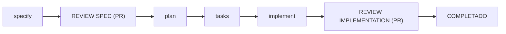

# Workflow SDD en un polyrepo



El **hub** conserva la especificación, los contratos, el plan y las tareas en `specs/<feature>/`. Los repositorios de servicios conservan el código. Cada repositorio tiene sus propios commits, remoto, ramas y PR: compartir un nombre de rama no los convierte en una única rama Git.

## Etapas

| Etapa | Resultado y revisión |
| --- | --- |
| `specify` | Genera `spec.md` y el checklist en una rama de feature del hub. |
| REVIEW SPEC (PR) | Se pushea esa rama al remoto del hub y se abre un PR hacia su rama base. Tras aprobarlo, se mergea la especificación antes de planificar. |
| `plan` | Genera `plan.md`, diseño y contratos en el hub; la tabla Affected Repositories identifica los repositorios afectados. |
| `tasks` | Genera `tasks.md` en el hub. La extensión multi-repo-sync puede crear y seleccionar la rama de feature en los repositorios afectados. |
| `implement` | Modifica el código en cada servicio y actualiza las tareas y evidencias en el hub. Los commits pertenecen al repositorio donde se producen. |
| REVIEW IMPLEMENTATION (PR) | Revisa el conjunto: un PR del hub con plan, tareas y artefactos, más un PR por cada repositorio de código modificado. |
| COMPLETADO | Todos los PR requeridos están mergeados y las validaciones acordadas han pasado. Merge no equivale por sí solo a despliegue en producción. |

Después del primer PR, actualizar la rama base local del hub y continuar en una rama de feature basada en ella. Si la rama de `specify` fue eliminada, recrearla desde la base actualizada, conservando el identificador de feature que resuelve Spec Kit. No generar plan ni tareas directamente en la rama base.

## REVIEW IMPLEMENTATION: push y merge por repositorio

**El plan y las tareas no se mergean mediante los PR de servicios.** Sus commits quedan en la rama del hub y necesitan un segundo PR del hub. Los PR de servicios solo integran el código en la rama base de su propio repositorio, normalmente `main` o la rama de integración acordada.

Ejemplo de push para el hub y el servicio actual, ejecutado desde la raíz del hub; sustituir `<feature>` por la rama real:

```powershell
git push -u origin <feature>
git -C repos/repo-service-sdd-polyrepo-poc push -u origin <feature>
```

Estos comandos publican commits ya creados; no hacen commit, no abren PR ni mergean. Abrir cada PR en su repositorio de GitHub, seleccionando su propia rama base. Repetir el push y la apertura de PR por cada repositorio adicional afectado.

Para una feature que modifica dos servicios, el conjunto de PR sería:

| PR | Repositorio | Qué integra |
| --- | --- | --- |
| Spec | Hub | `spec.md` y checklist; mergeado antes de `plan`. |
| Implementación: artefactos | Hub | `plan.md`, `tasks.md`, diseño, contratos y evidencias actualizadas. |
| Implementación: servicio A | Servicio A | Código y tests de A hacia la rama base de A. |
| Implementación: servicio B | Servicio B | Código y tests de B hacia la rama base de B. |

Con N repositorios de código modificados, esta revisión necesita **1 PR del hub + N PR de código**; el PR inicial de spec es adicional. Si hay varias ramas destino dentro de un mismo repositorio, puede requerirse más de un PR allí.

### Coordinación y casos de merge parcial

1. Vincular todos los PR mediante el identificador de feature y enlaces cruzados. El PR del hub funciona como punto de seguimiento del conjunto.
2. Revisar que el código cumple el spec y los contratos, que las tareas reflejan lo realizado y que pasan los checks de cada repositorio y las pruebas de integración pertinentes.
3. Mergear los PR de código según sus dependencias. Por ejemplo, integrar primero un proveedor compatible antes de su consumidor. Si el cambio rompe compatibilidad, acordar una transición y un orden de despliegue; Git no resuelve esa coordinación.
4. Como convención de cierre, actualizar en la rama del hub las evidencias y enlaces a los PR mergeados, pushear esos últimos commits y mergear el PR del hub al final. Así el cierre documental refleja el resultado completo.
5. Declarar COMPLETADO solo cuando todo el conjunto esté integrado y validado. Una tarea implementada o un PR aprobado no significa que todos los repositorios estén mergeados.

Si un PR se bloquea o falla tras un merge parcial, mantener la feature pendiente y registrar lo que falta. Los merges de repositorios distintos **no son atómicos**: no hay rollback conjunto automático. Decidir una corrección o un revert explícito en los repositorios afectados según el impacto. Si el PR del hub se mergea antes que los servicios, la feature sigue pendiente; las actualizaciones posteriores del seguimiento necesitan otro PR del hub.

## Qué automatiza el workflow actual

El [workflow configurado](../../.specify/workflows/speckit/workflow.yml) ejecuta `specify`, un gate de revisión de spec, `plan`, un gate adicional de revisión de plan, `tasks` e `implement`. El esquema anterior resume el proceso solicitado: la revisión del plan se mantiene antes de generar tareas.

Los gates son aprobaciones del workflow, **no PR de GitHub**. El YAML actual no define un gate final de revisión de implementación ni acciones de push, apertura o merge de PR. Esas operaciones son pasos operativos del proceso aquí descrito, no automatizaciones garantizadas.

La [extensión de auto-commit](../../.github/skills/speckit-git-commit/SKILL.md) crea commits locales si el evento está habilitado; no publica ni mergea esos commits. La [sincronización multi-repo](../../.github/skills/speckit-multi-repo-sync-sync/SKILL.md) gestiona ramas en los repositorios afectados; no sincroniza commits ni PR. Verificar el estado Git de cada repositorio antes de publicar.